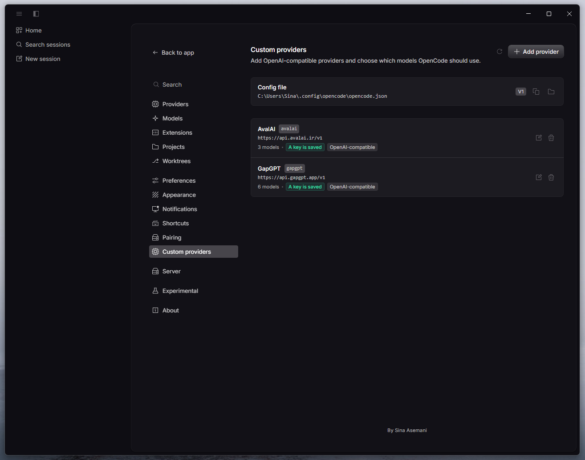

# OpenCode custom providers

A GUI plugin for **OpenCode Desktop** that adds, edits and deletes
OpenAI‑compatible providers without hand‑editing `opencode.json`.

It adds a **Settings → Custom providers** page (and a `Custom providers: manage`
command) where you can point OpenCode at any OpenAI‑compatible, OpenAI
Responses, or Anthropic‑compatible endpoint, fetch its model list, and choose
which models show up in the model picker.

The plugin UI ships in English and Farsi.



## Features

- Add providers with name, ID, base URL, API key and API compatibility
  (OpenAI chat, OpenAI Responses, Anthropic).
- **Fetch models** from `GET {baseURL}/models`, with fallbacks for the usual
  endpoint variants, and keep the metadata the endpoint returns: context and
  output limits, tool support, vision, reasoning and pricing.
- Search and filter the fetched list, select all / clear, hide non‑chat models
  (embeddings, TTS, image, rerank, …), or add model IDs manually.
- Edit and delete existing providers. Renaming keeps the stored key.
- Per‑model context/output limits, editable inline.
- Bilingual UI (English / Farsi) that follows the Desktop language.

## Install

Requires OpenCode Desktop 2.2 or newer.

### From GitHub

```bash
opencode plugin add github:mrsinasky/OpenCode-Custom-Providers
```

Or add the spec to your global config (`~/.config/opencode/opencode.json`,
on Windows `%USERPROFILE%\.config\opencode\opencode.json`):

```jsonc
{
  "plugins": ["github:mrsinasky/OpenCode-Custom-Providers"]
}
```

Then restart OpenCode Desktop once. Open **Settings → Custom providers**.

```

### From a local clone

```bash
git clone https://github.com/mrsinasky/OpenCode-Custom-Providers.git
cd OpenCode-Custom-Providers
npm install
npm run build
```

Then point the config at the folder:

```jsonc
{
  "plugins": ["C:\\path\\to\\OpenCode-Custom-Providers"]
}
```

`dist/gui-experimental.cjs` is committed, so a clone works without building;
`npm run build` is only needed after changing the source.

## Usage

1. Open **Settings → Custom providers** (or run the command
   **“Custom providers: manage”** from the command palette).
2. Press **Add provider** and fill in:
   - **Display name** — anything you like, e.g. `My gateway`.
   - **Provider ID** — lowercase identifier used as the model prefix, e.g.
     `mygateway`.
   - **Base URL** — the API root, usually ending in `/v1`.
   - **API key** — stored in the config. Leave it blank when editing to keep
     the saved key. `{env:VARIABLE}` references are supported.
   - **Package** — OpenAI‑compatible, OpenAI Responses, or Anthropic‑compatible.
3. Press **Fetch models**, pick the models you want, optionally adjust their
   context/output limits, then **Save**.
4. The models appear in the model picker as `providerID/modelID`.

The page also shows the config file in use (V1 or V2), and can copy or reveal
its path.

## What it writes

The plugin detects the config format and keeps it:

| | V1 (`provider`) | V2 (`providers`) |
| --- | --- | --- |
| package | `npm` | `package` |
| endpoint / key | `options.baseURL`, `options.apiKey` | `settings.baseURL`, `settings.apiKey` |
| model limits | `limit.context`, `limit.output` | `limit.context`, `limit.output` |
| capabilities | `tool_call` | `capabilities` |

- Existing keys, comments and fields the plugin does not manage are preserved.
- A `.bak` copy of the config is written before every change.
- V1 model entries only receive `name`, `limit` and `tool_call`; OpenCode 2.x
  rejects the legacy `attachment`/`reasoning` fields with a warning.
- API keys are masked in the UI and never logged.

Packages used per compatibility mode:

| Compatibility | V1 | V2 |
| --- | --- | --- |
| OpenAI‑compatible | `@ai-sdk/openai-compatible` | `@opencode/ai/providers/openai-compatible` |
| OpenAI Responses | `@ai-sdk/openai-compatible` | `@opencode/ai/providers/openai-compatible/responses` |
| Anthropic‑compatible | `@ai-sdk/anthropic` | `@opencode/ai/providers/anthropic-compatible` |

## Development

```bash
npm install
npm run typecheck   # tsc --noEmit
npm run build       # builds dist/gui-experimental.cjs
npm run watch       # rebuild the GUI bundle on change
```

Layout:

```
src/
  index.ts        server plugin: registers the RPC handlers
  config.ts       config discovery, V1/V2 read/write, backup, key handling
  discovery.ts    GET /models fetching and metadata normalization
  rpc.ts          RPC contract (shared by server and GUI)
  types.ts        shared types
  gui.tsx         GUI entry: settings page, command, styles
  gui/            page, editor dialog, i18n catalogue, CSS
dist/
  gui-experimental.cjs   prebuilt GUI bundle loaded by OpenCode Desktop
```

While developing against a local checkout, `npm run watch` rebuilds the bundle
and OpenCode Desktop reloads the GUI automatically.

## License

MIT — see [LICENSE](LICENSE).
